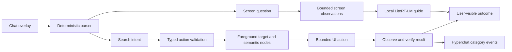

# Hyperchat architecture

Hyperchat targets place search and screen guidance over an unmodified Naver Map app. Its Kotlin Android host supplies the chat overlay, accessibility service, policy, and execution. It uses the Android foreground UI and runs as a sideloaded APK. The search path uses neither an AppFunction nor a Naver Map API.

| Boundary | Contract |
| --- | --- |
| Overlay | Collect one query and show progress, completion, cancellation, or an actionable error. Keep app operations explicit and cancellable. |
| Request routing | `/search` and supported Korean search commands produce a typed search with a bounded query. Other inputs are screen questions. The guide cannot dispatch an action. |
| Model guide | With a compatible imported `.litertlm` model, LiteRT-LM `0.19.1` answers questions from bounded foreground observations. UI text is evidence, never an instruction. |
| Accessibility | Restrict search and screen content capture to Naver Map and the test fixture. Match semantic IDs, roles, or labels and refresh the foreground state before each input. |
| Verification | Require query evidence from a result surface or explicit result summary. A typed query, autocomplete, or accepted gesture does not prove success. Missing evidence remains unverified. |
| Diagnostics | Record only coarse Hyperchat events such as an unsupported target, cancelled action, timeout, or verified result. Keep queries, raw node trees, screenshots, credentials, and imported model paths out of logs. Do not use another app's process logs as evidence. |

## Shortcut routing

The collapsed accessibility overlay handles taps and upward swipes that start on its 48 dp chat bubble. A long press followed by a drag saves the bubble's position. The accessibility-button callback, launcher shortcut and managed-device intent use the same system shortcut mapping. Each mapping opens chat, opens Hyperchat settings, or stays disabled according to the saved preference.

A stationary hold adds a focusable delete overlay while the bubble keeps the initial touch stream. Starting a drag dismisses the delete overlay and moves the bubble. The delete action saves a visibility preference, which the service applies when it reconnects. Settings can restore the bubble independently of the configured shortcut action.

`ShortcutActivity` accepts the explicit `dev.hanzicho.hyperchat.action.OPEN_SHORTCUT` action on an unlocked device and passes it to the connected accessibility service. Search still requires a separate confirmation in the composer. [Shortcut setup](../README.md#open-hyperchat-with-a-shortcut)

## Attachments

The composer registers gallery, UTF-8 text and local model settings in `ComposerAction`. The non-exported picker activity returns one selected attachment to the current overlay draft. Gallery photos use bundled on-device text recognition. The prompt receives only a bounded text excerpt and treats it as data. The attachment path cannot dispatch a search action. Replacing or removing the attachment clears it from the draft.

Add another picker or capability through the same action list. A vision-model action would need an image-capable model path. An MCP connector would need a separate connection and tool-approval flow before it can run actions.

## Search scenario

1. The user enables the service, opens Naver Map, submits `/search Seoul Station` through the overlay, and selects `검색 실행`.
2. The executor validates the action and checks the foreground package, window, and search target. It stops on ambiguity or a change of foreground app.
3. It opens or selects the search input and supplies the query. It clicks a unique search control if present. On Android 13 or later it can use the focused editor's advertised `IME_ACTION_SEARCH` after checking the editor package, window and field value. Waiting is bounded and depends on observed state.
4. It looks for the committed query header, Places tab and result container on Naver Map 6.12.1.1. This checks arrival at the result screen. When the check times out after submission, the overlay reports that the query was sent and asks the user to check Naver Map. Result availability depends on Naver Map's connection and service.

| Failure | Expected behavior |
| --- | --- |
| Service disabled, wrong app, or missing target | Stop before input and identify the missing condition. |
| User cancels or changes apps | Stop dispatching UI actions. Ignore a stale model response after cancellation. |
| Unexpected app version, unknown screen, or timeout | Return an unverified outcome. Do not claim a result or repeat the action blindly. |
| Missing or incompatible model | Report screen guidance as unavailable. The deterministic search path remains separate. |

## Evidence levels

| Claim | Evidence required |
| --- | --- |
| Buildable | The exact revision assembles; list the command and environment. |
| Policy and parser work | Automated assertions for accepted and rejected typed actions. |
| Android UI path works on the fixture | Run against the supplied fixture and assert the actual observed outcome. Fixture evidence is not Naver Map evidence. |
| Works with Naver Map | Run the unmodified app on Android and assert the observed result. Record the emulator configuration separately from any Galaxy and One UI run. |
| On-device inference works | A real supported model initializes and produces a result on the target, separately from import, fixture, or stub success. |

Room replay, a shared skill registry, server/local negotiation, and AOSP/OEM integration are beyond this prototype. A successful APK run does not show integration with Samsung firmware.
